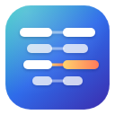

# Recolign

2つの表のファイル（CSV、TSV、固定長のテキストなど）を、キーの列でレコードどうしを対応させて比べ、どの値が変わったか、どのレコードが片方にしかないかを確かめるWindowsアプリです。

**すべてこのPCの中で動きます。アプリは外部と通信せず、比べるデータをどこにも送りません。**

## ダウンロード

[Releases](https://github.com/okakanatto/Recolign/releases/latest) から `Recolign.exe` をダウンロードして実行します。インストールも管理者権限も要りません。

- 動作環境：Windows 10／11（64ビット）。画面の表示に、Windows 10／11に標準で入っている WebView2 ランタイムを使います。
- コード署名をしていないため、初めて開くときにWindowsの警告（SmartScreen）が出ることがあります。そのときは「詳細情報」→「実行」を選びます。
- 使い方は [操作説明](docs/manual.md) にあります。比較画面で F1 を押すと、キー操作の一覧が出ます。

## できること

- 行の順番や列の順番が違うファイルどうしを、キー（社員番号など。複数の列の組み合わせも可）で対応させて比べます。値は書き換えずに、文字どおりに比べます。
- 差分を「変更」「左のみ」「右のみ」「一致」に分け、左右の表に元の値のまま並べます。変わったセルと、セルの中で変わった文字を示します。
- 区切り（カンマ、タブ、セミコロン、縦線、任意の1文字）、引用符を使わないファイル、固定長を読めます。文字コードは UTF-8、Shift_JIS（Windows-31J）、UTF-16、EUC-JP です。左右で違っていてもかまいません。
- 文字コード・区切り・1行目が列名かどうか・キーを、ファイルの中身から推定します。キーの値の重複や空の値は、比べる前にその場所を示します。
- 同じような変更のまとめ（変更パターン）、確認済み・要調査の印とメモ（使うときだけオンにします）、検索、Excel形式（差分に色付き）とCSVへの書き出し、Excelと同じキー操作。

## 安全のための作り

### 通信しない

- アプリには、外部と通信する部品が入っていません。テレメトリ（利用状況の送信）、自動更新、アカウントやサインインもありません。
- 画面の表示に使う WebView2 がそれ自体で行う通信（更新の確認など）も、起動時の設定で止めています。
- Windows でのビルドのたびに、自動のテストでアプリを起動して比較させ、その間の外部への接続が0件であることを確かめています（`tools/net_check.ps1`）。

### 比べるファイルを変えない

- 比べるファイルは読み取り専用で開き、書き換えません。書き出し先に比べているファイルを選んだときは、書き出しを断ります。
- 読み込みの途中でファイルが書き換わったときは、比較を止めてそのことを知らせます。

### データを残さない

比べたデータは、アプリを開いている間だけメモリの上にあり、データの複製をファイルに作りません。ファイルに保存するのは次のものだけです。

| 保存するもの | 中身 |
|---|---|
| 画面の設定 | 表の配置・拡大率・書き出しの選択など（ファイル名や値は含みません） |
| 最近の比較 | ファイルの場所とキーの列名（変更パターンのまとめから外した列の名前も）。設定で記録をやめると、記録も消します |
| 確認状況とメモ | 使うとオンにしたときだけ。キーの値・確認の状態・メモ・日時で、データの複製は作りません。設定から削除できます |
| 不具合の記録（crash.log） | プログラムの不具合が起きた場所だけ。ファイルの値は書きません |

このほか、画面の表示部品（WebView2）が動くための作業用フォルダを、ユーザーのフォルダに作ります（比べたデータは入れません）。保存先は [操作説明](docs/manual.md) にあります。

コピーした内容は、設定で、Windows のクリップボードの履歴（Win+V）とほかの端末との同期に残らないようにできます。

データを守る設定（最近の比較を記録するか、コピーをクリップボードの履歴に残すか、CSV の書き出しで式として動く値に `'` を付けるか）は、exe の隣の設定ファイルではなく、ユーザーのフォルダに保存します。exe を共有フォルダに置いても、ほかの人がこれらを切ることはできません。

### 開いたファイルの中身を信用しない

- ファイルの値は文字として表示するだけで、HTML やスクリプトとして扱いません。
- CSV に書き出すとき、表計算ソフトで式として動く値（`=`、`+`、`-`、`@` で始まる値。全角を含む）には、既定で先頭に `'` を付けます。Excel 形式では、値をすべて文字のセルとして書きます。
- メモリが足りなさそうなときは比べる前に知らせ、比較の途中で足りなくなりそうなときは、理由を示して止めます。極端に長い値や多すぎる列にも上限を設け、画面が固まらないようにしています。
- exe が使う DLL は、Windows のシステムフォルダからだけ読み込みます。

### 中身を確かめられる

- ソースコードをすべて公開しています（MIT License）。
- 配布している exe は、このリポジトリのソースから GitHub Actions で作ったものです。添えてある SHA-256 と、ビルドの来歴の証明（`gh attestation verify Recolign.exe --repo okakanatto/Recolign`）で確かめられます。
- 使っている部品の版は固定し、既知の脆弱性を、変更のたびと毎週、自動で検査しています。

### ご利用にあたって

このソフトウェアは MIT License のもと、現状のまま提供します。上に書いたことは、そのように作り、テストで確かめているという意味です。あらゆる状況での安全や正しさを保証するものではなく、利用によって生じた結果について、作者は責任を負いません。脆弱性を見つけたときの連絡方法は [SECURITY.md](SECURITY.md) にあります。

## 開発

- 必要なもの：Rust（stable）、Node.js 22。画面の自動テストには Python 3 と Playwright。
- 比較の処理（`engine/`）と画面から呼ぶ命令（`service/`）のテスト：`cargo test`
- 画面（`app/`）：`cd app && npm ci && npm run build`。開発用のハーネス（`cargo build --release -p cdr-harness`）で画面をブラウザで動かし、`python tools/ui_test.py --harness target/release/cdr-harness` で自動テストを行います。
- Windows アプリ：Windows で `cd app && npm ci && npx tauri build --no-bundle`（`target/release/cdr-desktop.exe` ができます）。
- 配布：`.github/workflows/release.yml`。

## ライセンス

MIT License（[LICENSE](LICENSE)）。exe に含まれるほかのソフトウェアのライセンスは、配布物の `THIRD-PARTY-LICENSES.txt`（アプリの「設定」→「ライセンス情報」）にあります。
